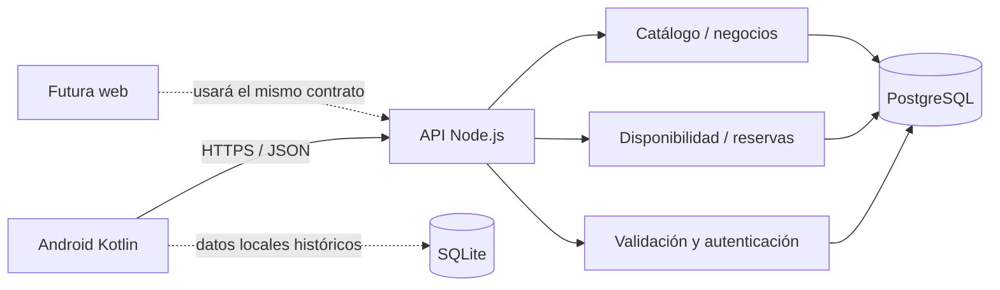

# Arquitectura para escalar y habilitar una futura versión web

## 1. Decisión principal

UNAMAD es un **sistema de citas y reservas**. El catálogo/marketplace solamente facilita encontrar negocios y servicios. Disponibilidad, asignación, idempotencia, estados y persistencia de una reserva compartida deben vivir en el backend y PostgreSQL.

La futura web consumirá la misma API REST que Android. No debe copiar reglas de disponibilidad ni escribir directamente en PostgreSQL.

## 2. Arquitectura actual



- **Android:** UI nativa en Kotlin; las Activities son presentación; `MarketplaceApiClient` encapsula HTTP y sesión; los datos de reserva se envían al API.
- **API:** Node.js 22, REST versionada (`/api/v1`), validación de dominio, JWT, roles y consultas parametrizadas.
- **Persistencia:** PostgreSQL es la autoridad compartida; SQLite conserva la agenda antigua del dispositivo y no confirma citas nuevas.
- **Contrato:** `docs/api/openapi.yaml` y `docs/api/CONTRATO_API_V1.md` describen los endpoints para que un cliente web pueda implementarlos sin depender de Android.

## 3. Cambios concretos de esta versión para rendimiento

1. **Paginación keyset del catálogo:** 24 negocios por defecto, máximo 50, cursor basado en `(created_at, id)` y orden determinista. Evita descargar 60 o cientos de filas en una sola respuesta y no usa `OFFSET` creciente.
2. **Índices PostgreSQL:** orden del catálogo, categoría, distrito y búsqueda parcial con `pg_trgm` (`GIN`). Se agregan mediante la migración `004_marketplace_pagination.sql`.
3. **Android IO acotado:** un executor compartido de 4 hilos y cola de 96 tareas. Si se llena, la pantalla recibe un error controlado; no se crean hilos ilimitados ni un executor por Activity.
4. **Reservas seguras:** PostgreSQL valida disponibilidad en transacción, asigna trabajador o recurso e impide solapamientos del mismo recurso. La clave idempotente permite repetir una petición sin crear otra reserva.
5. **Payload y visualización:** el cliente solo recibe el bloque solicitado del catálogo; Android añade páginas cuando el usuario pide ver más.

Estos cambios reducen trabajo por consulta, pero **no demuestran una capacidad máxima de usuarios ni garantizan soportar cualquier pico**. La capacidad debe medirse en un entorno equivalente a producción.

## 4. Qué falta para soportar picos importantes

| Área | Estado | Siguiente paso recomendado |
|---|---|---|
| API stateless | JWT y API REST; no depende de estado de pantalla Android. | Mantener todas las sesiones compartidas fuera de la memoria del proceso. |
| Limitador de solicitudes | Actualmente usa mapa en memoria por proceso. | Para varias réplicas, mover rate limiting a Redis o gateway compartido. |
| Pool PostgreSQL | Pool `pg` limitado a 15 conexiones por proceso. | Medir concurrencia; al escalar réplicas, fijar presupuesto global y evaluar PgBouncer. |
| Búsquedas | Cursor e índices de filtro/búsqueda agregados. | Ejecutar `EXPLAIN (ANALYZE, BUFFERS)` con datos representativos y revisar selectividad. |
| Observabilidad | Respuestas de error controladas; faltan métricas centralizadas. | Añadir logs estructurados sin secretos, métricas de latencia, tasa 4xx/5xx y saturación del pool. |
| Pruebas de carga | No ejecutadas en esta entrega. | k6 o herramienta equivalente contra staging y datos sintéticos, midiendo P95/P99. |
| Escalado | Monolito modular, una instancia de API en Compose. | Añadir reverse proxy/load balancer y réplicas de API; PostgreSQL gestionado/HA según volumen real. |
| Procesos lentos | No hay cola para tareas diferidas. | Incorporar cola solo cuando existan notificaciones, reportes o integraciones que lo requieran. |

No recomiendo microservicios en esta etapa. Un monolito modular, con API horizontalmente replicable y transacciones PostgreSQL, es más sencillo y suficiente hasta que las métricas demuestren otra necesidad.

## 5. Estructura objetivo del backend

```text
backend/src/
  modules/
    auth/           # registro, login, emisión/verificación de sesión
    businesses/     # negocios, membresías, horarios
    catalog/        # categorías, publicaciones y búsqueda paginada
    availability/   # turnos, zona horaria y asignación
    reservations/   # creación, idempotencia, estados y cancelación
    staff/          # trabajadores y recursos
  shared/
    http/           # lectura JSON, respuestas y errores
    database/       # pool, transacciones y contexto RLS
    security/       # JWT, hash y permisos
  server.js         # arranque y composición de rutas
```

La versión actual ya extrae validaciones de dominio, seguridad, DB y paginación; `server.js` todavía concentra muchas rutas. La división por módulos es una refactorización progresiva futura: no se copia todo a carpetas nuevas sin tests de regresión.

## 6. Estructura objetivo Android

```text
app/src/main/java/com/example/comunamadsistemacitas/
  core/             # tema, componentes comunes, configuración, errores
  domain/           # modelos y reglas Kotlin sin Android ni JSON
  data/
    remote/         # HTTP, DTOs, sesión y mapeadores
    local/          # SQLite histórico y caché futura
    repository/     # coordinación de fuentes
  presentation/
    portal/         # portal y navegación
    catalog/        # búsqueda/listado/detalle
    booking/        # fecha, turno y confirmación
    account/        # acceso y perfil
    business/       # panel y administración
```

La estructura actual conserva `view/`, `model/`, `data/remote/`, `data/local/` y `data/repository/`. Conviene migrar por funcionalidad y añadir ViewModels cuando se haga la siguiente iteración; no se fuerza Compose, porque la actividad de curso solo exige una app funcional en Kotlin y las pantallas existentes son nativas con XML/Views.

## 7. Preparación de la futura web

La web puede desarrollarse de forma independiente (por ejemplo React, Vue o Angular), consumiendo exactamente:

- `GET /api/v1/categories`
- `GET /api/v1/businesses?limit=24&cursor=...`
- `GET /api/v1/businesses/{id}/availability`
- `POST /api/v1/me/reservations` con `Idempotency-Key`
- `GET /api/v1/me/reservations`
- endpoints de panel de negocio y gestión de reservas.

Condiciones para que la web reutilice correctamente el backend:

1. Mantener el contrato OpenAPI actualizado y versionar cambios incompatibles.
2. Configurar CORS solo para los dominios web autorizados.
3. Mantener autorización y validación en servidor; no confiar en botones ocultos del navegador.
4. No exponer credenciales PostgreSQL al navegador.
5. No duplicar en JavaScript el cálculo de disponibilidad: la web consulta el mismo endpoint.
6. Compartir estados, reglas e idempotencia a través del backend, no sincronizar dos bases independientes.

## 8. Próxima secuencia técnica

1. Importar y sincronizar en Android Studio; resolver cualquier incompatibilidad específica de la instalación local.
2. Ejecutar Debug, pruebas unitarias y pruebas instrumentadas.
3. Aplicar las migraciones 003 y 004 en PostgreSQL de staging, nunca directamente sobre producción sin backup.
4. Probar concurrencia real: dos clientes por el mismo recurso y otros dos por recursos distintos.
5. Medir con carga representativa; documentar P95/P99 y errores.
6. Extraer ViewModels y módulos backend de forma incremental, conservando la API v1.
7. Con el contrato estable, crear el cliente web sin reescribir las reglas del negocio.
