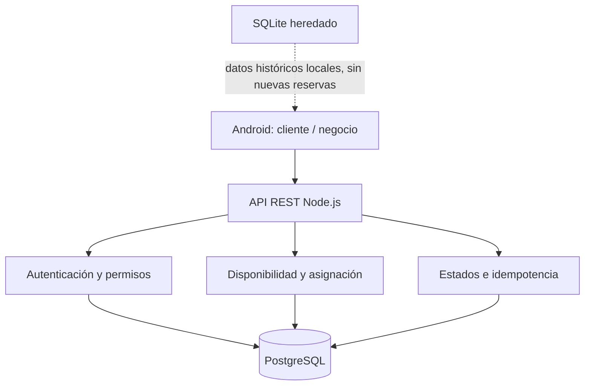
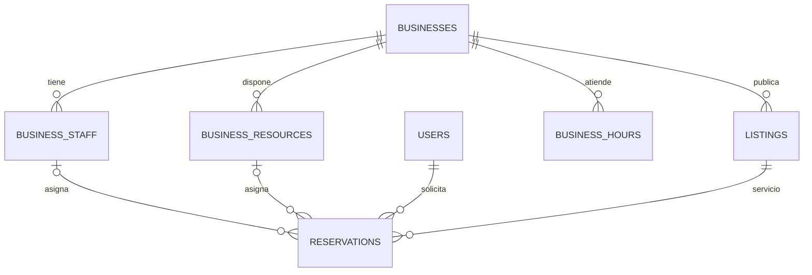

# Arquitectura — UNAMAD Sistema de Citas y Reservas

## 1. Principio

UNAMAD es un sistema de citas y reservas. El marketplace es una puerta para descubrir el negocio y el servicio; no mantiene un calendario independiente. La reserva se confirma como solicitud solamente cuando PostgreSQL la registra correctamente.



PostgreSQL es la fuente de verdad compartida. SQLite se conserva en el dispositivo para no destruir el historial anterior, pero la navegación principal ya no permite registrar citas nuevas allí. No hay sincronización bidireccional de reservas ni se debe simular una reserva exitosa offline.

## 2. Modelo de asignación



Cada cita reserva un asignado (trabajador o recurso). La base impide solapamientos del mismo asignado mediante una exclusión GiST con rango `[starts_at, ends_at)`. Dos trabajadores diferentes pueden atender en paralelo; dos recursos diferentes permiten capacidad paralela para negocios sin personal individual.

- Si el negocio tiene trabajadores activos, el flujo actual ofrece y autoasigna trabajadores.
- Si no tiene trabajadores activos, utiliza recursos de atención.
- Se crea un recurso virtual por negocio para mantener compatibilidad con negocios existentes.
- La transición de citas ya asociadas a recursos bloquea los intervalos de recursos ocupados cuando se empiezan a utilizar trabajadores.
- Por ahora, todos los trabajadores heredan la jornada semanal global del negocio. La jornada individual y las excepciones por fecha son trabajo posterior.

## 3. Flujo de consulta y creación de una cita

```mermaid
sequenceDiagram
  participant App as Android
  participant API as Node.js
  participant DB as PostgreSQL
  App->>API: GET /businesses/{id}/availability?listingId&date
  API->>DB: Zona horaria + horario semanal + duración del servicio
  DB-->>API: Turnos libres por trabajador/recurso
  API-->>App: Lista de turnos y asignado real
  App->>App: Usuario selecciona turno; guarda clave idempotente local
  App->>API: POST /me/reservations + Idempotency-Key
  API->>DB: BEGIN + identidad RLS
  API->>DB: Advisory lock cliente+clave
  DB-->>API: Reserva existente o ninguna
  API->>DB: Lock trabajador/recurso + revalidar horario/ocupación
  API->>DB: INSERT reserva + pago pendiente
  DB->>DB: UNIQUE idempotencia + EXCLUDE asignado
  API->>DB: COMMIT
  API-->>App: Código y estado SOLICITADA
```

La lista de disponibilidad es una vista previa. El backend comprueba nuevamente servicio activo, modalidad, jornada y asignación justo antes de insertar. Si otro cliente ocupa el turno primero, la segunda operación recibe conflicto y no se registra como exitosa.

## 4. Idempotencia

- Clave de 8–128 caracteres por cliente y petición lógica.
- Índice único `(customer_user_id, idempotency_key)`.
- Huella SHA-256 del negocio, publicación, fecha, modalidad, cantidad, medio de pago, nota y asignación.
- Advisory transaction lock por cliente+clave antes de consultar la operación previa.
- Mismo payload: devuelve la reserva/código existente.
- Payload distinto con la misma clave: HTTP 409.
- Pago pendiente y decremento de stock se ejecutan una sola vez en la transacción inicial.
- Android persiste una clave por solicitud en preferencias privadas antes del POST; el ámbito se deriva del ID estable del usuario (`sub`) y del contenido, así la renovación del JWT no rompe el reintento y dos reservas pendientes distintas no se sobrescriben.

## 5. Roles y datos

- Cliente: explora, consulta turnos, solicita/cancela sus propias reservas y consulta historial.
- Propietario/Manager: configura servicios, horarios, trabajadores y recursos; consulta y gestiona reservas de su negocio.
- Trabajador: el modelo de membresía prevé el rol, pero una política de permisos más granular por asignación queda pendiente.
- Administrador general: no se ha incorporado un rol global en este alcance.

RLS y autorización de API se verifican en servidor; ocultar controles Android no es autorización.

## 6. Migraciones

- `001_bootstrap.sh`: rol runtime `marketplace_app`, sin `BYPASSRLS`.
- `002_marketplace.sql`: esquema multiempresa y reglas originales.
- `003_appointment_resources_idempotency.sql`: trabajadores, recursos, asignación histórica, idempotencia y exclusiones por asignado.
- `004_marketplace_pagination.sql`: índices para cursor, categoría, distrito y búsqueda parcial del catálogo.

Los scripts en `/docker-entrypoint-initdb.d` solo se ejecutan en un volumen nuevo. En una instalación existente se debe hacer backup y aplicar la migración 003 explícitamente como propietario. Ver `backend/README.md`.

## 7. Arquitectura Android

Se mantiene el cliente API y pantallas existentes, sin reescribir todo el proyecto:

```text
app/src/main/java/.../
  view/          # Activities y componentes visuales
  data/remote/   # API HTTP, sesión cifrada y paginación
  data/local/    # SQLite histórico; caché futura, no reserva autoritativa
  data/repository/
  model/
```

No se fuerza Compose: la app no usa composables en las pantallas auditadas. El portal y el panel de operación usan API remota. `ProcesoReservaActivity`, `MainActivity`, `RegistroNegocioActivity`, `RegistroClienteActivity`, `MarketplaceActivity` y `PanelNegocioActivity` son rutas de compatibilidad que redirigen al flujo central. El catálogo Android carga 24 negocios por página y limita a 120 tarjetas renderizadas por búsqueda.

## 8. Trabajo posterior

- Jornadas individuales por trabajador/recurso, pausas, feriados y excepciones.
- Pruebas de integración con PostgreSQL real y test de 2+ transacciones concurrentes.
- Build Debug/Release y pruebas instrumentadas en Android Studio.
- Conciliación/importación explícita de datos históricos SQLite.
- Revocación de JWT, notificaciones y pasarela de pagos.
